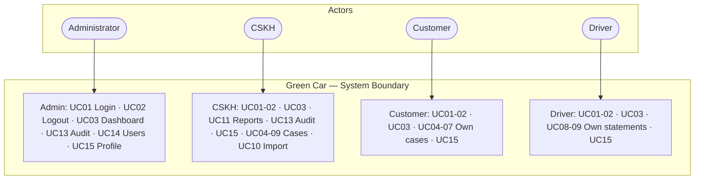
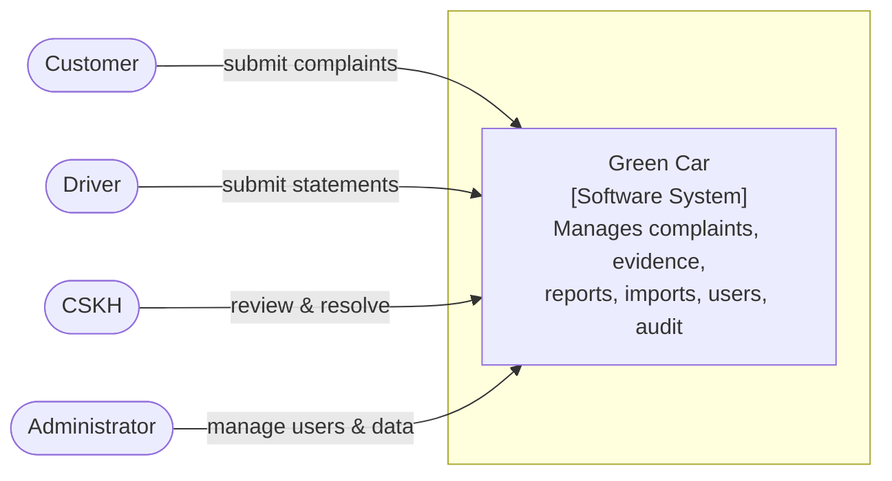
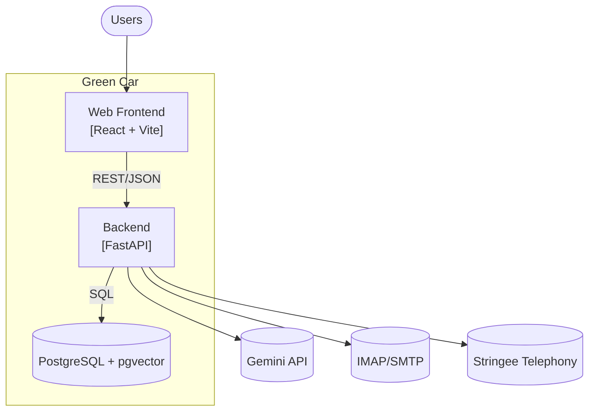
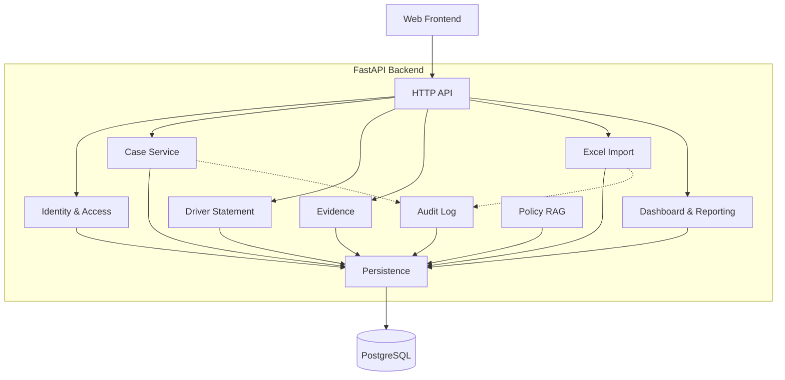
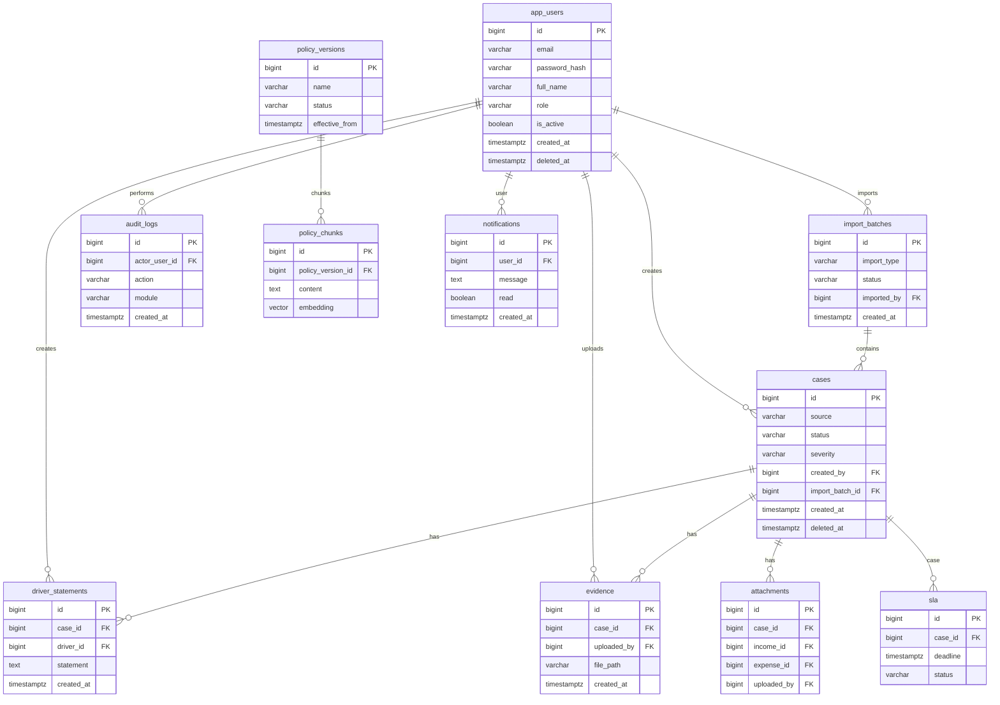
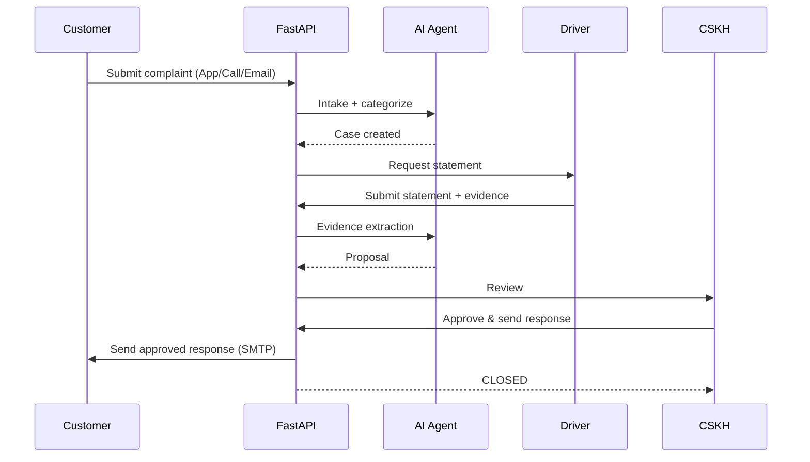

# Green Car

Complaint management system for a transport company: receiving customer complaints, driver statements, evidence, CSKH review and response.

## 1. Requirements — INVEST, Use Cases, and Acceptance Criteria

### 1.1 Product mind map


### 1.2 INVEST requirements

| Criterion | Meaning in Green Car |
|---|---|
| Independent | Each story provides a clear capability; depends on others only when necessary. |
| Negotiable | UI and technical details may change as long as the main goal (case lifecycle) and permission rules remain. |
| Valuable | Each story delivers value to customers, drivers, CSKH, or the business. |
| Estimable | Roles, inputs, outputs, dependencies, and error outcomes (SLA, email sending) are documented. |
| Small | Each story covers one capability and can be split into API, agent node, persistence, UI, and test tasks. |
| Testable | Every story maps to observable acceptance criteria and expected authorization/validation/error behavior. |

```
US01–US02   Authentication and session
US03        Dashboard
US04–US06   Complaint intake (App/Call/Email)
US07–US09   Driver statements and evidence
US10        Import Excel
US11–US12   Reports and export
US13        Audit log
US14        User management
US15        Personal profile and password
US16        Policy RAG and evaluation
US17        SLA and notifications
```

### 1.3 Use cases



Roles: Admin, CSKH, Customer, Driver. Flow: App/Call/Email → case → statement → evidence → CSKH review → send result → CLOSED.

### 1.4 Roles and permissions

| Capability | Admin | CSKH | Customer | Driver |
|---|---|---|---|---|
| View dashboard/case | Yes | Yes | Yes (own) | Yes (own) |
| Create complaint | Yes | Yes | Yes | No |
| Edit case | Yes | Yes | Own | No |
| Soft delete | Yes | Yes | No | No |
| Import Excel | Yes | Yes | No | No |
| Reports | Yes | Yes | No | No |
| Audit log | Yes | Yes | No | No |
| User management | Yes | No | No | No |

Backend must enforce RBAC; hiding controls in frontend is UX only.

## 2. Information Architecture, Screen Hierarchy, and UI/UX

### 2.1 Information architecture

```
Public
└── Login

Authenticated
├── Dashboard
├── Cases (App/Call/Email)
├── Driver Statements
├── Evidence
├── Reports
├── Import
├── Audit
├── Users
├── Profile
└── Forbidden
```

### 2.2 Screen hierarchy
Login → authenticated shell → feature pages; interactions use modals. Unauthorized navigation → Forbidden.

### 2.3 UI prototype

#### Login


#### Dashboard

## 3. C4 Architecture

### C1 — System Context



### C2 — Container



### C3 — Component



## 4. Database Diagrams and OpenAPI 3.0 Contract

### 4.1 Database



See the [detailed database diagram](docs/DATABASE.md), [data model](docs/05-data-model.md),

### 4.2 OpenAPI 3.0 API documentation


## 5. Folder structure

### Current repository layout

```
Green Car/
├── README.md
├── .gitignore
├── docs/
│   ├── 01-scope.md
│   ├── 02-features.md
│   ├── 03-use-cases.md
│   ├── 04-information-architecture.md
│   ├── 05-data-model.md
│   ├── 06-acceptance-criteria.md
│   ├── 07-folder-structure.md
│   ├── 08-invest-requirements.md
│   ├── DATABASE.md
│   ├── requirements/
│   │   ├── business-rules.md
│   │   └── non-functional-requirements.md
│   ├── api/
│   │   └── openapi.yaml
│   ├── architecture/
│   │   └── c4/
│   │       └── README.md
│   ├── traceability/
│   │   └── matrix.md
│   ├── images/
│   │   ├── dashboard.png
│   │   └── login.png
│   ├── mindmap.png
│   └── AI Agent for complaint handling.pptx
└── src/
    ├── backend/
    └── frontend/
```

### Target Green Car backend layout

```
src/
├── main.py, config.py, core.py
├── api/
├── modules/
├── agents/
├── integrations/
├── rag/
├── db/
├── services/
├── repositories/
└── security/
```

## 6. Detailed Class and Sequence Design

### Case lifecycle sequence



- Class diagrams: Auth, Case, Driver Statement, Evidence, Import, Reporting, Audit, RAG.
- Sequence diagrams: intake, categorization, handling, driver complaint, evidence extraction, CSKH review, send response, audit.

## Documentation
Documentation lives in the `docs/` folder of the project. See the Green Car repository for full details.

## Project Progress (early stage)
- [x] Define scope, goals, and roles
- [x] Write feature list and use cases
- [ ] Write user stories following INVEST
- [ ] Write acceptance criteria and business rules
- [ ] Design information architecture and screen permissions
- [ ] Design C4 and arc42 documentation
- [ ] Design PostgreSQL schema, DBML, and relationships
- [ ] Write API documentation in OpenAPI 3.0
- [ ] Design React frontend folder structure
- [ ] Design three-tier backend folder structure
- [ ] Design class diagrams and sequence diagrams
- [ ] Create traceability between requirements, screens, API, and database
- [ ] Build the three-tier backend
- [ ] Build authentication, user management, and personal profile API
- [ ] Implement case CRUD API
- [ ] Complete dashboard, reports, import, attachments, and audit API
- [ ] Write unit tests and API integration tests
- [ ] Connect React frontend to the API
- [ ] Implement Excel import with row-level preview and PDF/XLSX report export
- [ ] Record audit events for create, update, delete, login, logout, import, and export
- [ ] Add frontend tests with Vitest
- [ ] Complete PostgreSQL migrations and integration tests against a real database
- [ ] Add durable file storage for imports and attachments
- [ ] Standardize JWT, rate limiting, authorization, and security tests