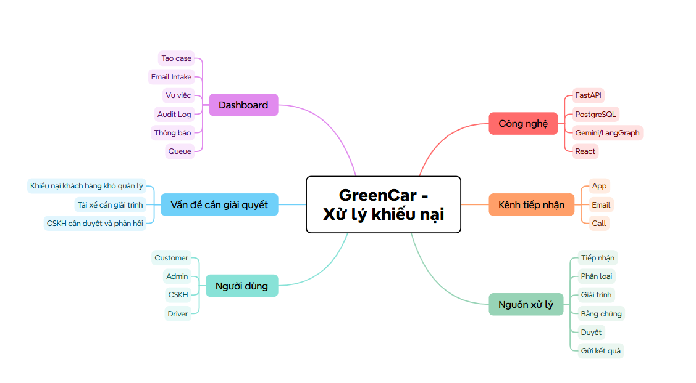
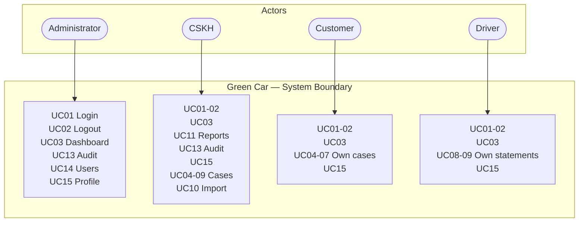
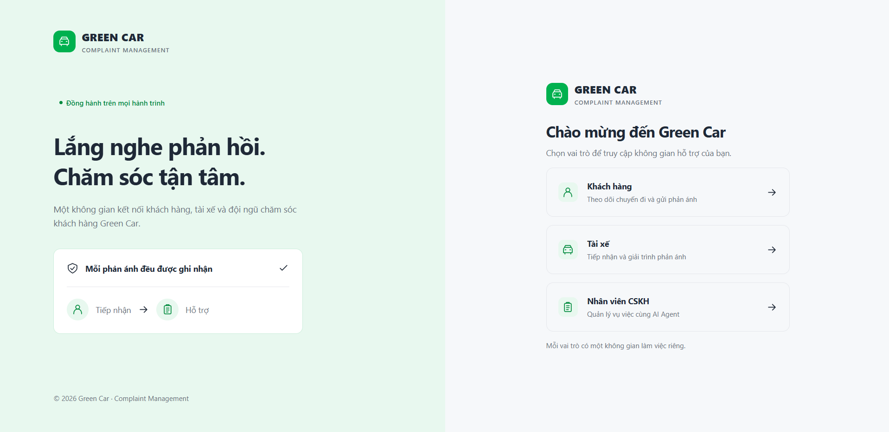
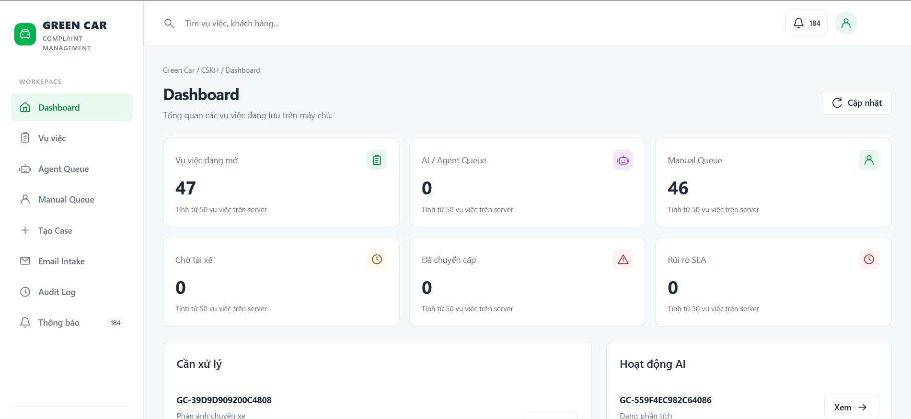
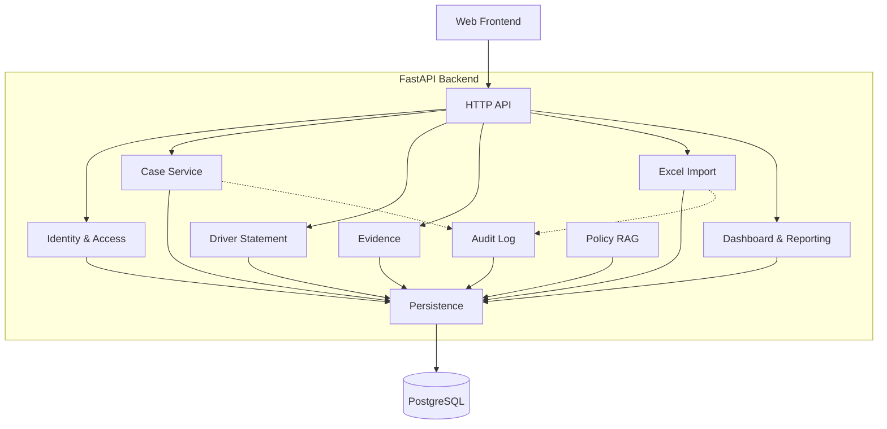
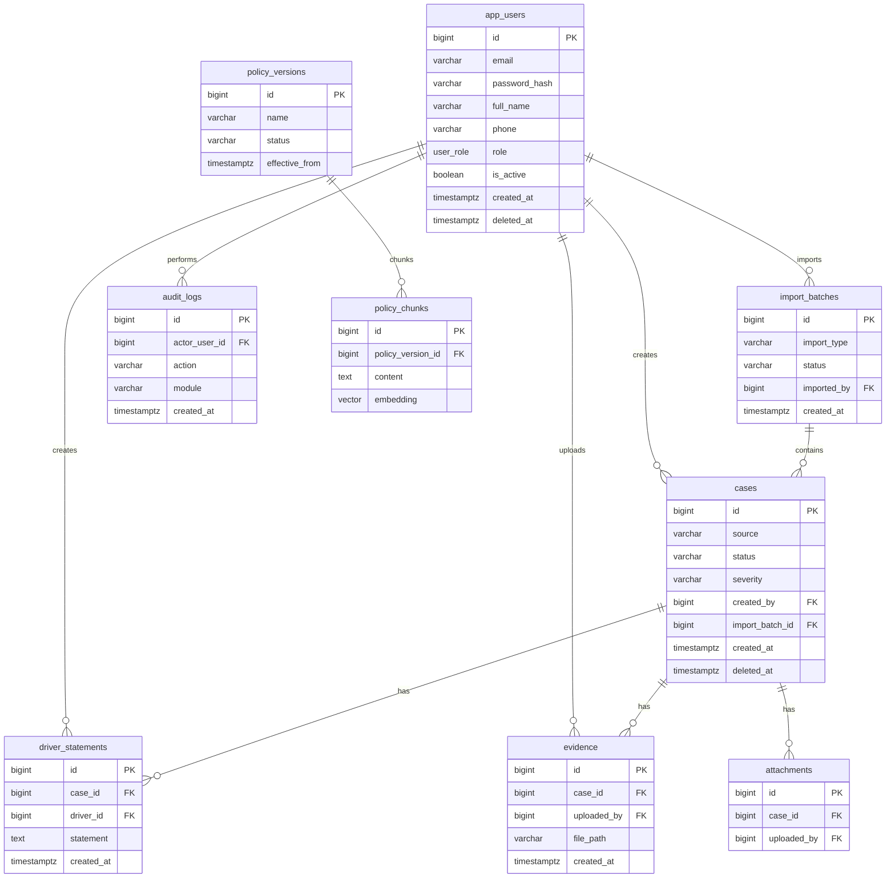
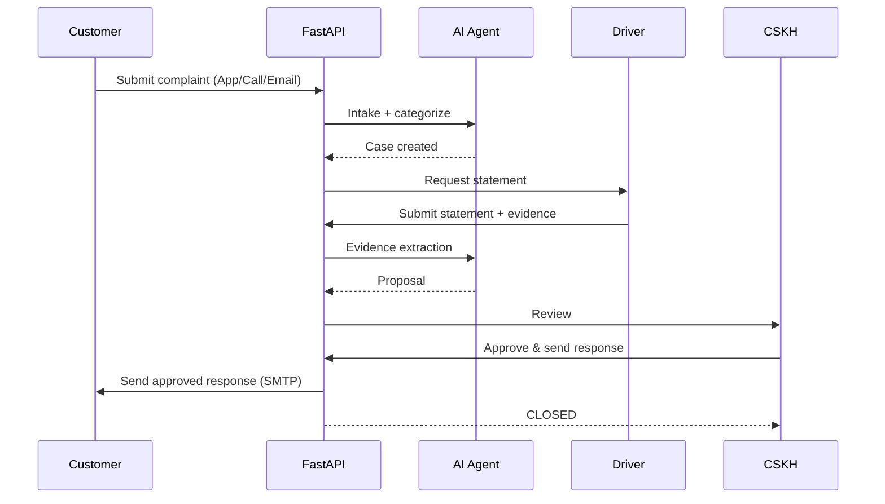
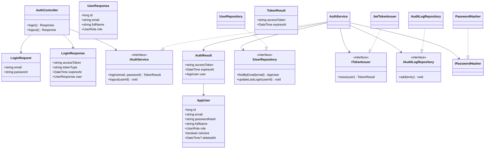
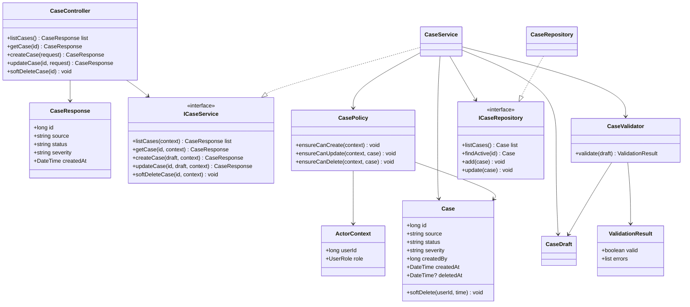
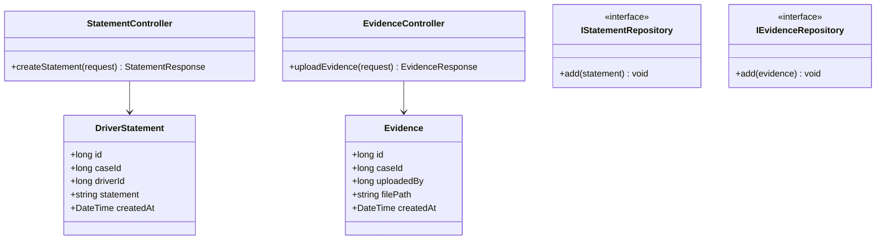

# Green Car

Complaint management system for a transport company: receiving customer complaints, driver statements, evidence, CSKH review and response.

## 1. Requirements — INVEST, Use Cases, and Acceptance Criteria

### 1.1 Product mind map



### 1.2 INVEST requirements

| Criterion | Meaning in Green Car |
|---|---|
| Independent | Each story provides a clear capability; depends on others only when necessary. |
| Negotiable | UI and technical details may change as long as the main goal (case lifecycle) and permission rules remain. |
| Valuable | Each story delivers value to customers, drivers, CSKH, or the business. |
| Estimable | Roles, inputs, outputs, dependencies, and error outcomes (SLA, email sending) are documented. |
| Small | Each story covers one capability and can be split into API, agent node, persistence, UI, and test tasks. |
| Testable | Every story maps to observable acceptance criteria and expected authorization/validation/error behavior. |

```
US01–US02   Authentication and session
US03        Dashboard
US04        View cases
US05        Complaint intake (App)
US06        Complaint intake (Call)
US07        Complaint intake (Email)
US08        Driver statement
US09        Evidence & attachments
US10        Import Excel
US11–US12   Reports and export
US13        Audit log
US14        User management
US15        Personal profile
US16        Policy RAG
US17        SLA and notifications
```

### 1.3 Use cases



For detailed actors, permissions, and business flows, see [Actors, roles, and use cases](docs/03-use-cases.md).

### 1.4 Roles and permissions

| Capability | Admin | CSKH | Customer | Driver |
|---|---|---|---|---|
| View dashboard/case | Yes | Yes | Yes (own) | Yes (own) |
| Create complaint | Yes | Yes | Yes | No |
| Edit case | Yes | Yes | Own | No |
| Soft delete | Yes | Yes | No | No |
| Import Excel | Yes | Yes | No | No |
| Reports | Yes | Yes | No | No |
| Audit log | Yes | Yes | No | No |
| User management | Yes | No | No | No |

Backend must enforce RBAC; hiding controls in frontend is UX only.

## 2. Information Architecture, Screen Hierarchy, and UI/UX

### 2.1 Information architecture

```
Public
└── Login

Authenticated
├── Dashboard
├── Cases (App/Call/Email)
├── Driver Statements
├── Evidence
├── Reports
├── Import
├── Audit
├── Users
├── Profile
└── Forbidden
```

### 2.2 Screen hierarchy
Login → authenticated shell → feature pages; interactions use modals. Unauthorized navigation → Forbidden.
Detailed screen IDs, user flows, screen states, accessibility rules, and API mappings are maintained in [Information Architecture](docs/04-information-architecture.md).

### 2.3 UI prototype

#### Login



#### Dashboard

## 3. C4 Architecture

### C1 — System Context


### C2 — Container


### C3 — Component



## 4. Database Diagrams and OpenAPI 3.0 Contract

### 4.1 Database



See the [detailed database diagram](docs/DATABASE.md), [data model](docs/05-data-model.md),
and [traceability matrix](docs/traceability/matrix.md).

### 4.2 OpenAPI 3.0 API documentation

The HTTP contract is defined with OpenAPI 3.0.4 and organized into Authentication, Dashboard, Cases, Driver Statements, Evidence, Reports, Imports, Audit, Users, and Profile.

```
18 paths
26 operations
Bearer JWT security
Role-based access (ADMIN, CSKH, CUSTOMER, DRIVER)
JSON request/response contracts
Reusable request/response schemas
Application error responses
Request, success, and error examples
```

Every operation has a stable `operationId`, documented parameters, request and response schemas, success/error status codes, and target authorization rules. The contract is a design source of truth; the backend runtime has not been implemented yet.

- [OpenAPI 3.0.4 specification](docs/api/openapi.yaml)

## 5. Folder structure

### Current repository layout

```
Green Car/
├── README.md
├── .gitignore
├── docs/
│   ├── 01-scope.md
│   ├── 02-features.md
│   ├── 03-use-cases.md
│   ├── 04-information-architecture.md
│   ├── 05-data-model.md
│   ├── 06-acceptance-criteria.md
│   ├── 07-folder-structure.md
│   ├── 08-invest-requirements.md
│   ├── DATABASE.md
│   ├── requirements/
│   │   ├── business-rules.md
│   │   └── non-functional-requirements.md
│   ├── api/
│   │   └── openapi.yaml
│   ├── architecture/
│   │   └── c4/
│   │       └── README.md
│   ├── traceability/
│   │   └── matrix.md
│   ├── images/
│   │   ├── dashboard.png
│   │   └── login.png
│   ├── mindmap.png
│   └── AI Agent for complaint handling.pptx
└── src/
    ├── backend/
    └── frontend/
```

### Target Green Car backend layout

```
src/
├── main.py, config.py, core.py
├── api/
├── modules/
├── agents/
├── integrations/
├── rag/
├── db/
├── services/
├── repositories/
└── security/
```

## 6. Detailed Class and Sequence Design

### 6.1 Case lifecycle sequence



### 6.2 Core class diagrams

#### Authentication



#### Case



#### Driver Statement & Evidence



### 6.3 Sequence diagrams

- **Intake** — Customer submits complaint → API → AI Agent categorizes → Case created
- **Categorization** — AI Agent classifies group, looks up trip, assesses severity
- **Handling** — Driver submits statement + evidence → AI aggregates & cross-checks → AI proposes handling direction
- **Driver complaint** — Driver submits statement → linked to case → CSKH notified
- **Evidence extraction** — AI extracts evidence details → confidence score → flagged for review if low
- **CSKH review** — CSKH reviews AI proposal → approves, edits, or rejects → sends response
- **Send response** — Approved response sent via SMTP to customer → case marked CLOSED
- **Audit** — Every create/update/delete/login/import/export written to audit_logs

### 6.4 Remaining design

Class diagrams for Reporting, Import, Audit, and RAG modules, plus additional sequence diagrams for import validation, report generation, and notification flows, are planned but not yet documented.


## Documentation

Documentation lives in the `docs/` folder of the project.

- Requirements: [Scope](docs/01-scope.md), [Features](docs/02-features.md), [INVEST backlog](docs/08-invest-requirements.md), [Acceptance criteria](docs/06-acceptance-criteria.md)
- Requirements catalogs: [Business rules](docs/requirements/business-rules.md), [Non-functional requirements](docs/requirements/non-functional-requirements.md)
- UI/UX: [Information architecture](docs/04-information-architecture.md)
- Database: [Data model](docs/05-data-model.md), [ER diagram](docs/DATABASE.md)
- Folder structure: [React and three-tier backend](docs/07-folder-structure.md)
- API contract: [OpenAPI 3.0.4 specification](docs/api/openapi.yaml)
- Traceability: [Master traceability matrix](docs/traceability/matrix.md)

## Project Progress
- [x] Define scope, goals, and roles
- [x] Write feature list and use cases
- [x] Write user stories following INVEST
- [x] Write acceptance criteria and business rules
- [x] Write non-functional requirements
- [x] Design information architecture and screen permissions
- [x] Design C4 System Context, Container, Component diagrams
- [x] Design PostgreSQL schema, tables, and relationships
- [x] Write API documentation in OpenAPI 3.0
- [x] Design backend folder structure
- [ ] Design React frontend folder structure
- [x] Design class diagrams and sequence diagrams
- [x] Create traceability between requirements, screens, API, and database
- [ ] Build the three-tier backend
- [ ] Build authentication, user management, and personal profile API
- [ ] Implement case CRUD API
- [ ] Implement AI agent / LangGraph integration (intake, categorization, evidence extraction)
- [ ] Implement Policy RAG (US16)
- [ ] Implement SLA monitoring and notifications (US17)
- [ ] Implement IMAP email complaint ingestion (US07)
- [ ] Implement Stringee Telephony integration for call complaints
- [ ] Complete dashboard, reports, import, attachments, and audit API
- [ ] Write unit tests and API integration tests
- [ ] Connect React frontend to the API
- [ ] Implement Excel import with row-level preview and PDF/XLSX report export
- [ ] Record audit events for create, update, delete, login, logout, import, and export
- [ ] Add frontend tests with Vitest
- [ ] Complete PostgreSQL migrations and integration tests against a real database
- [ ] Add durable file storage for imports and attachments
- [ ] Standardize JWT, rate limiting, authorization, and security tests