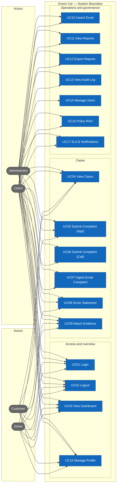
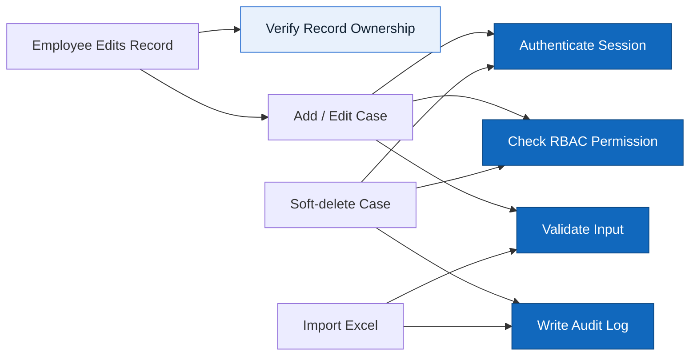

# Actors, roles, use cases

> Design status: TARGET V1

Product name: **Green Car**.

## Actors / roles

| Role | Display name in UI |
|---|---|
| `ADMIN` | Administrator |
| `CSKH` | CSKH Agent |
| `CUSTOMER` | Customer |
| `DRIVER` | Driver |

## Role × feature matrix

| Feature | Admin | CSKH | Customer | Driver |
|---|---|---|---|---|
| Dashboard | ✓ | ✓ | ✓ (own) | ✓ (own) |
| View cases | ✓ | ✓ | ✓ (own) | ✓ (own) |
| Submit complaint (App) | ✓ | ✓ | ✓ | |
| Submit complaint (Call) | ✓ | ✓ | | |
| Submit complaint (Email) | system | system | | |
| Driver statement | | | | ✓ |
| Attach evidence | ✓ | ✓ | ✓ | ✓ |
| Import Excel | ✓ | ✓ | | |
| View reports | ✓ | ✓ | | |
| Export reports | ✓ | ✓ | | |
| Audit log | ✓ | ✓ | | |
| User management | ✓ | | | |
| Personal profile | ✓ | ✓ | ✓ | ✓ |

Unauthorized URL access → Forbidden screen.

## Use Case Diagram

## Shared rules and constraints

Backend enforces RBAC; menus/buttons hidden when lacking permission.

## Use cases

### UC01 Login
- **Actor:** all roles
- **Preconditions:** an active account exists
- **Main flow:** enter credentials → submit login → backend verifies → return session → Dashboard
- **Permission:** public
- **Result:** authenticated session

### UC02 Logout
- **Actor:** all roles
- **Main flow:** invoke logout → clear client auth state → login
- **Permission:** authenticated
- **Result:** client session cleared

### UC03 View Dashboard
- **Actor:** all roles
- **Main flow:** choose date range → KPIs + charts + recent cases
- **Permission:** dashboard
- **Result:** dashboard dataset

### UC04 View cases
- **Actor:** all roles
- **Main flow:** list active cases + filters + detail
- **Permission:** caseRead
- **Result:** case list

### UC05 Submit complaint (App)
- **Actor:** Customer, CSKH, Admin
- **Main flow:** form → validation → create case with source=APP → audit
- **Permission:** caseCreate
- **Result:** case created

### UC06 Submit complaint (Call)
- **Actor:** CSKH, Admin
- **Main flow:** CSKH enters call details → create case with source=CALL → audit
- **Permission:** caseCreate
- **Result:** case created

### UC07 Ingest email complaint
- **Actor:** system (IMAP poll)
- **Main flow:** poll IMAP → extract → find trip → run agent → create case with source=EMAIL
- **Permission:** system
- **Result:** case created

### UC08 Driver statement
- **Actor:** Driver
- **Main flow:** submit statement + evidence for a case
- **Permission:** statementCreate
- **Result:** statement recorded

### UC09 Attach evidence
- **Actor:** all roles (own case)
- **Main flow:** upload file → link to case → audit
- **Permission:** evidenceUpload
- **Result:** evidence linked to case

### UC10 Import Excel
- **Actor:** Admin, CSKH
- **Main flow:** choose file → validate/preview → atomic import → summary
- **Permission:** importData
- **Result:** imported rows or validation errors

### UC11 View reports
- **Actor:** Admin, CSKH
- **Main flow:** filters by time/category → aggregates
- **Permission:** reportRead
- **Result:** report dataset

### UC12 Export reports
- **Actor:** Admin, CSKH
- **Main flow:** export PDF/XLSX using current filters
- **Permission:** reportRead
- **Result:** exported file

### UC13 View audit log
- **Actor:** Admin, CSKH
- **Main flow:** view audit events
- **Permission:** auditRead
- **Result:** audit list

### UC14 Manage users
- **Actor:** Admin
- **Main flow:** list, add/edit, enable/disable users
- **Permission:** userManagement
- **Result:** user list updated

### UC15 Personal profile
- **Actor:** all roles
- **Main flow:** update profile fields, change password with current password verification
- **Permission:** authenticated
- **Result:** profile updated

### UC16 Policy RAG
- **Actor:** system
- **Main flow:** retrieve relevant policies for a case
- **Permission:** system
- **Result:** relevant policy chunks

### UC17 SLA & notifications
- **Actor:** system/CSKH
- **Main flow:** monitor SLA deadlines, send notifications
- **Permission:** system/cskh
- **Result:** notifications sent / SLA tracked
