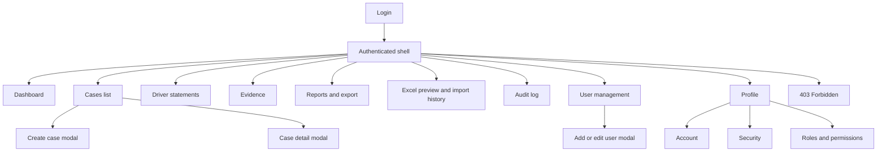

# Information architecture

> Design status: TARGET V1
> 
> Current implementation: React mock prototype; no real API integration

```
Green Car
│
├── Public
│   └── Login
│
└── Authenticated (sidebar + topbar)
    ├── Dashboard
    ├── Cases
    │   ├── List (table, filters, columns, pagination)
    │   ├── Detail modal
    │   └── Create modal
    ├── Driver Statements
    ├── Evidence & Attachments
    ├── Reports
    ├── Excel Import
    ├── Audit Log
    ├── User Management
    ├── Personal Profile
    │   ├── Account
    │   ├── Security
    │   └── Roles & Permissions
    └── 403
```

Hash routes: `#/login` `#/dashboard` `#/cases` `#/cases/:id` `#/reports` `#/import` `#/audit` `#/users` `#/profile` `#/403`.

## Page permissions

| Page | Who can access |
|---|---|
| Dashboard, profile | all roles |
| Cases (view) | all roles |
| Create/edit cases | according to matrix |
| Reports | ADMIN, CSKH |
| Excel Import | ADMIN, CSKH |
| Audit Log | ADMIN, CSKH |
| Users | ADMIN only |
| Unauthorized | `#/403` |

Unauthorized items are not rendered in the sidebar.

## Screen inventory

| Screen ID | Screen | Presentation | Related stories | Status |
|---|---|---|---|---|
| SCR-01 | Login | Page | US01, US02 | Current mock and target |
| SCR-02 | Dashboard | Page | US03 | Current mock and target |
| SCR-10 | Cases list | Page | US04, US07 | Current mock and target |
| SCR-11 | Case detail | Modal | US04 | Current mock and target |
| SCR-12 | Case create | Modal | US05, US06, US07 | Current mock and target |
| SCR-20 | Driver statements | Page | US08 | Current mock and target |
| SCR-30 | Evidence | Page | US09 | Current mock and target |
| SCR-40 | Reports | Page | US11, US12 | Current mock and target |
| SCR-50 | Import | Page | US10 | Current mock; target integration pending |
| SCR-60 | Audit log | Page | US13 | Current mock and target |
| SCR-70 | User management | Page with form modal | US14 | Current mock and target |
| SCR-80 | Personal profile | Tabbed page | US15 | Current mock and target |
| SCR-90 | Forbidden | Page | Cross-cutting authorization | Current mock and target |

## Requirement-to-screen mapping

| Requirement | Primary screen/action |
|---|---|
| US01 | SCR-01 submit login |
| US02 | Authenticated shell logout action |
| US03 | SCR-02 change date range |
| US04 | SCR-10 filter/list and SCR-11 inspect case |
| US05 | SCR-12 submit case (App) |
| US06 | SCR-12 submit case (Call) |
| US07 | SCR-12 ingest email case |
| US08 | SCR-20 submit statement |
| US09 | SCR-30 upload evidence |
| US10 | SCR-50 preview, submit, inspect import |
| US11 | SCR-40 filter and inspect report |
| US12 | SCR-40 export report |
| US13 | SCR-60 filter and inspect audit |
| US14 | SCR-70 list/create/edit users |
| US15 | SCR-80 update profile or change password |
| US16 | System retrieval |
| US17 | System/CSKH SLA monitoring |

## Screen hierarchy



## UI/UX state contract

| State | Required behavior |
|---|---|
| Initial loading | Preserve page shell; show skeleton for affected panel/table. |
| Empty | Explain no records match; distinguish empty dataset from filtered-out results. |
| Validation error | Keep entered values, associate text with invalid field. |
| API error | Show concise message; do not expose technical details. |
| Unauthorized | Clear invalid authentication and return to Login. |
| Forbidden | Keep authentication and render 403 with safe route back. |
| Saving/importing | Disable duplicate submission and show progress. |
| Success | Confirm action, close modal when appropriate, refresh query. |
| Destructive confirmation | Name the record; state removal from active views retains audit history. |

## Responsive and accessibility rules

- Desktop tables retain full-column controls; narrow screens use horizontal scrolling.
- Modals fit viewport, keep actions visible, trap keyboard focus.
- Every input has visible label; icon-only buttons have accessible names.
- Keyboard users can reach navigation, filters, rows, modal actions, pagination.
- Dates and money have explicit formats.

## Screen-to-API mapping

| Screen | API operations |
|---|---|
| Login | login, logout |
| Dashboard | getDashboard |
| Cases | listCases, getCase, createCase, updateCase, softDeleteCase, uploadAttachment, deleteAttachment |
| Reports | getReport, exportReport |
| Import | previewImport, createImport, listImports, getImport |
| Audit | listAuditLogs |
| Users | listUsers, getUser, createUser, updateUser, updateUserStatus |
| Profile | getProfile, updateProfile, changePassword |

## Current mock UI versus target V1

The current mock UI is intentionally retained for UI development and demonstration. Target V1 adds real API, persistence, and backend authorization behind the same user-facing capabilities.
