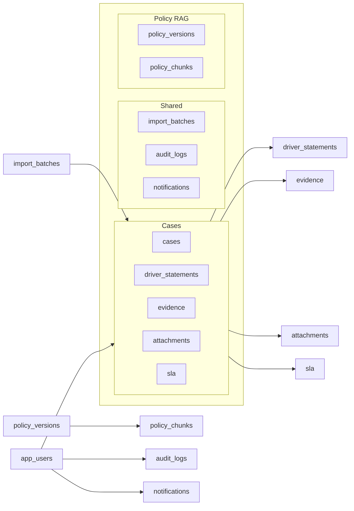
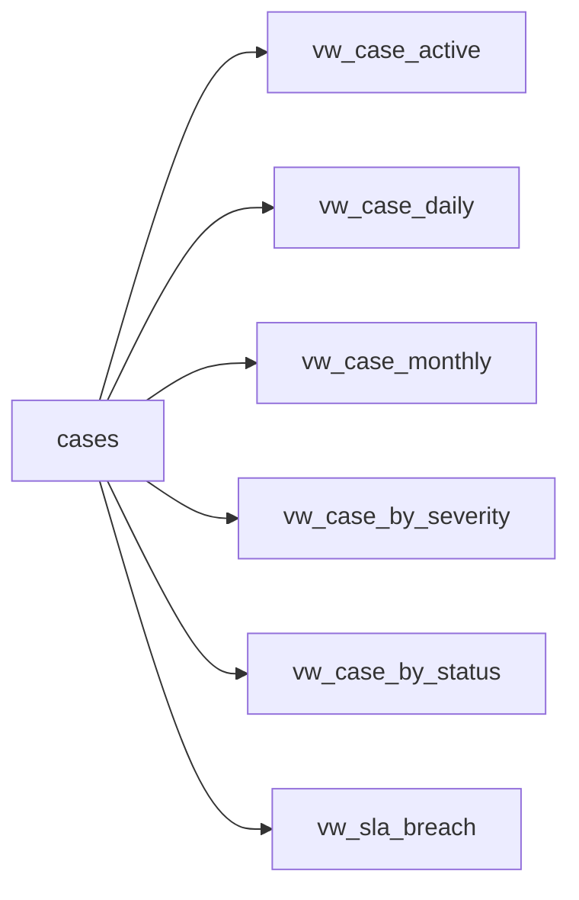
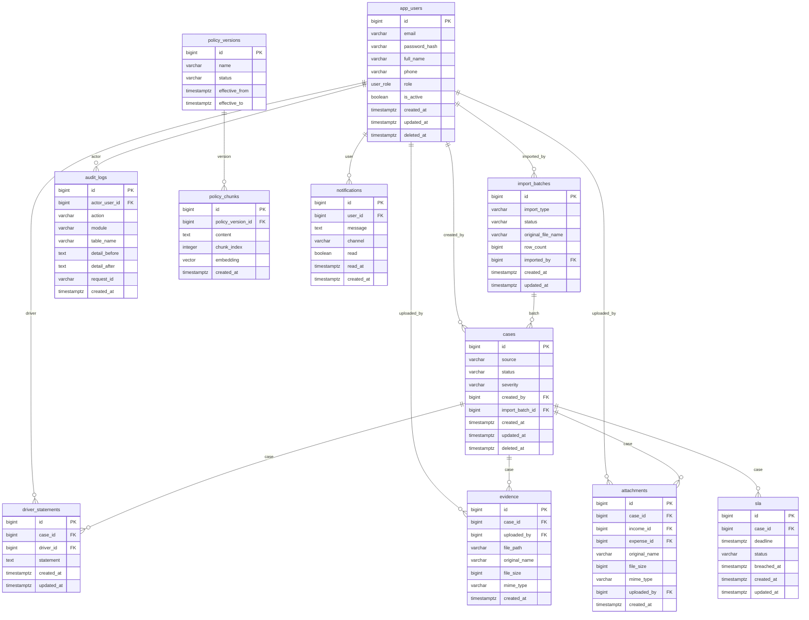

# Data Diagram

> Design status: TARGET V1
>
> Runtime status: NOT CONNECTED

PostgreSQL schema `green_car` for **Green Car**.

The interface uses **mock data** aligned with this model (tables, complaint cases, driver statements, evidence, attachments, soft delete, currency). The interface **does not connect** to PostgreSQL.

Design files: [05-data-model.md](05-data-model.md)

## Relationships (tables)

`app_users` is on the left. `cases` is central. `driver_statements`, `evidence`, `attachments`, and `sla` branch from `cases`. `import_batches` feeds `cases`. `policy_versions` feeds `policy_chunks`. `app_users` feeds `audit_logs` and `notifications`.

## Enums

| Enum | Values | UI |
|---|---|---|
| `user_role` | ADMIN, CSKH, CUSTOMER, DRIVER | Administrator, CSKH, Customer, Driver |
| `case_source` | APP, CALL, EMAIL | App, Call, Email |
| `case_status` | Intake, Categorization, In Progress, Resolved, Closed | Case status |
| `case_severity` | Low, Medium, High, Critical | Severity |
| `import_status` | PENDING, PROCESSING, COMPLETED, FAILED | Import-batch status |
| `audit_action` | CREATE, UPDATE, SOFT_DELETE, RESTORE, LOGIN, EXPORT, IMPORT | Audit log action |

## Views (report aggregates)

Views are **not stored tables**. They read active case records and aggregate by day / month / category / severity. In V1, `currency_code` is always `USD`; no foreign currency conversion.

## Detailed ER diagram (main columns)

Each attachment references exactly one parent through the SQL check constraint, while one case may own zero or many attachment rows.

## Audit security constraint

Audit data must never contain passwords, `password_hash`, JWTs, refresh tokens, or secrets. The current generic audit trigger serializes whole rows and therefore requires redaction for `app_users` before database implementation.

**Status:** REQUIRED BEFORE DATABASE IMPLEMENTATION. Audit records must include actor, entity type/id, timestamp, redacted before/after, and request/correlation ID when available. Soft-delete transitions map to `SOFT_DELETE`, and the inverse maps to `RESTORE`.
